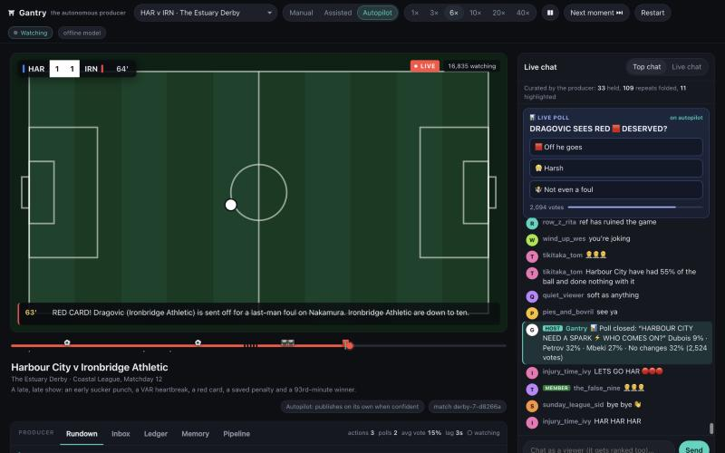
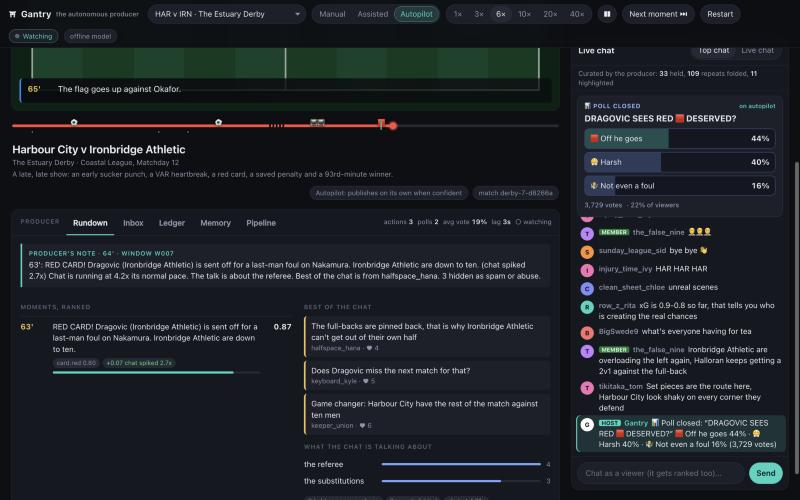
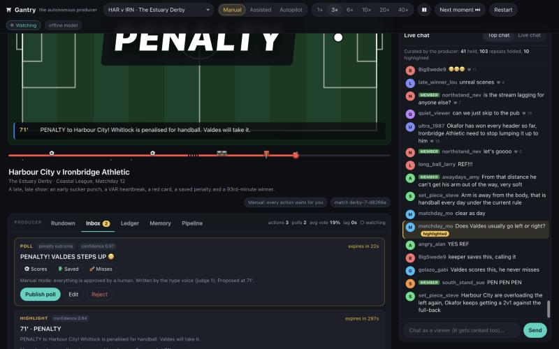
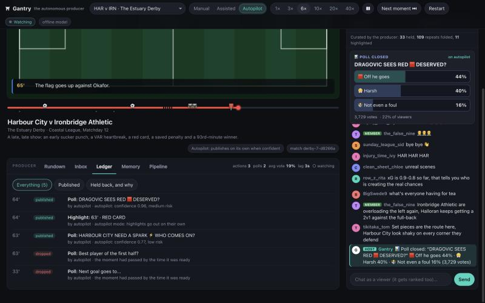
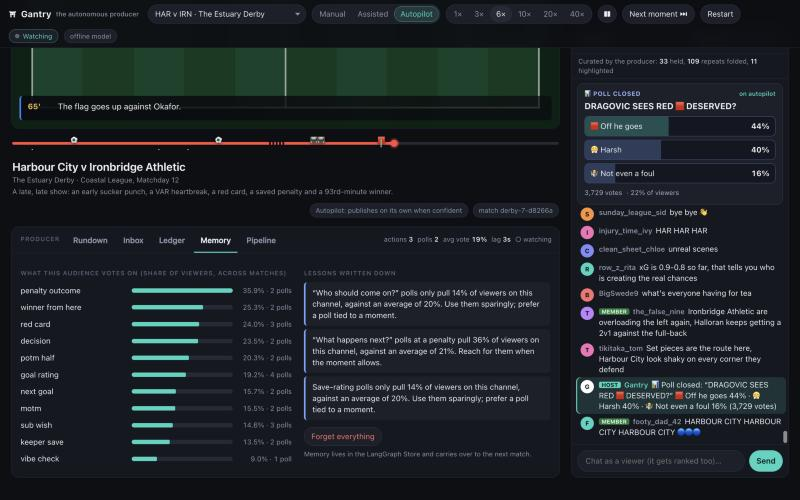

# Gantry

**An autonomous producer for a live sports stream, built as seven LangGraph graphs.** A commentary gantry is where the
people who call the game sit. This one is software: it watches a live sports data feed and a YouTube-style live chat,
ranks and curates what matters, then suggests (or, on autopilot, takes) actions. Polls first. It keeps a ledger of
everything it has done and learns what this audience votes on, so it can be left to run on its own.

It is the third sibling of Foghorn (`langgraph-app`) and Probably a Tragedy (`langgraph-fun`): same shape (one
deployment, many graphs, a custom FastAPI app with a no-build dashboard, Studio-ready, offline by default), with the
emphasis here on **real time and events**.

```bash
uv sync
make dev                      # langgraph dev on :2030 (provider + tracing come from .env)
open http://127.0.0.1:2030/app/
```

A match starts on autopilot at 10x. Watch a goal go in: about 25 match-seconds later the chat has been ranked, a
highlight is on the timeline and a poll is live. Switch to **Manual** and the same suggestions land in the Inbox with
a countdown instead. `make demo` plays a whole match in the terminal in about a second, with no server.



*A red card at 63'. The low-value "who comes on?" poll that was live is closed early, its result is posted by the
channel, and the red-card poll is out and collecting votes, all without a human.*

## A walkthrough video

The [**walkthrough video**](https://github.com/garyamorris/commentary-graph/releases/tag/v0.1.0) is narrated and captioned (5 minutes, 1080p, with a 720p copy;
download it from the release, since 117 MB of video stays out of git history). The `.srt`/`.vtt` captions are in [docs/demo](docs/demo). Everything in it is a recorded run of the real app against a real `langgraph dev`: the dashboard driven like a person (autopilot, a
penalty pushed into the feed, manual-mode approvals, the ledger, memory), and replays of real Agent Server runs on the real graph structure (nested
subgraphs, `Send` fan-out, parallel interrupts resumed by id). **It uses the offline model, and the narration says so.** How it was made, and how to
rebuild it: [docs/demo/video-source/README.md](docs/demo/video-source/README.md).

## The brief, and where each line of it lives

| Asked for | Where |
|---|---|
| "First flow is just ranking and curation of content" | `curator`: scores every feed event and every chat message, finds the themes, an editor re-ranks the shortlist. Drives the chat's **Top chat** view and the Rundown tab |
| "then generation of actions" | `action_desk`: proposes polls, highlights, pins and channel messages from the rundown, screens each one against policy and memory, then publishes or asks |
| "First feature will be take a live sports data feed and suggest polls" | `poll_studio`: three writers, a judge, a revise loop. Fed by `gantry.sim.match` (a deterministic live feed) or by `POST /api/matches/{id}/events` (your feed) |
| "it will need to know what it's done in the past" | The LangGraph Store: a per-match **ledger** of every action decided (and every one held back, with the reason), poll outcomes, per-template preferences across matches, written lessons |
| "so it can just run on its own" | An event-driven dispatcher fires `showrunner` on every trigger; **autopilot** publishes when confident and low-risk; policy enforces one poll at a time, gaps, no repeats; nothing ever waits on a human |

## A look at it

| | |
|---|---|
|  **Flow 1, the Rundown**: moments ranked with their reasons, best of the chat, themes |  **Flow 2 in Manual mode**: an urgent penalty poll, 22 seconds to decide |
|  **The Ledger**: what it did, what it held back, and why |  **Memory**: what this audience votes on, and the lessons written down |

## The seven graphs (`langgraph.json`)

| graph | what it does | LangGraph features |
|---|---|---|
| `showrunner` | **The loop.** One live window end to end: intake, triage, curate, act, wrap. What the dispatcher runs | subgraphs three deep, `Command(goto)` triage, interrupts bubbling to the top thread, one thread per window |
| `curator` | **Flow 1.** A two-stage ranker: deterministic features over everything, then a model re-ranks the shortlist | `Send` map-reduce over chat shards, reducers, `defer`, structured output with a validated fallback, token streaming |
| `action_desk` | **Flow 2.** Recall, propose, write the poll, screen, then one worker per action: ask or publish, and remember | Store + semantic search, **parallel interrupts resumed by id**, `Send` per action, idempotent effects above `interrupt()` |
| `poll_studio` | **The first feature.** Three voices draft the same poll in parallel; a rubric judges; failures get notes and another go | `Send` x3, evaluator loop, `Command(goto=[Send...])`, used as a subgraph |
| `memory_keeper` | Runs when a poll closes: files the outcome, updates what this audience likes, drafts a lesson when the evidence is in | Store namespaces, cross-thread memory, memory-write `interrupt` |
| `recap_press` | Half-time and full-time recaps from the ledger; full-time remembers half-time | Functional API (`@entrypoint`/`@task`, `previous`, `entrypoint.final`) |
| `producer_chat` | Ask the producer what it did and why | `create_agent` + middleware, `ToolRuntime`, `context_schema`, Studio chat mode |

Every graph starts with a `defaults` step, so Studio's blank form works: try `{}` or `{"fixture": "goalfest", "minute": 88}`.

## Real time and events

The **session** (`gantry.live.session`) owns the clock; the graphs own the judgement. Neither reaches into the other.

* **A virtual clock** at 1x to 40x, pause, and "next moment". Feed events and chat messages are released as the clock passes them.
* **An event-driven dispatcher**, not a poll loop. A key event arms a window 25 match-seconds later, so the chat's
  reaction is in it. A penalty fires in 6 (that poll is worthless in ninety). The whistles fire their own. A quiet three
  minutes fires a tick, because a lull is when a stream needs a producer most.
* **Windows are self-contained JSON** and each is its own thread, so a suggestion waiting on a human never blocks the
  broadcast, and any window can be replayed, forked or opened in Studio from its input alone.
* **Load shedding, not queueing.** One window in flight per match; triggers that arrive meanwhile ride along with the
  next one. `lag` (how far behind the clock the last window started) is on the dashboard.
* **The graph decides, the runtime applies.** A graph emits `action.publish`; the session opens the poll. It has the last
  word on timing: a poll that arrives after its moment is dropped and the ledger says so.
* **Time-aware policy.** One poll at a time, a gap between polls, a big moment may close a small poll early, and a poll
  that lost its slot is retried when the slot frees up if the moment is still fresh.
* **Safety inline, ranking in batch.** Spam, abuse and repeats are held the instant a message arrives; highlights come
  with the next window.
* **One ordered stream out** (SSE, `GET /api/matches/{id}/stream`) with sequence numbers and `Last-Event-ID` resume: a
  reconnecting browser gets exactly what it missed.
* **Your feed in.** `POST /api/matches/{id}/events` with an `Idempotency-Key` pushes a provider event into the same
  pipeline; from there it is ranked and can earn a poll like any other.

## Three modes

| | polls | pins, highlights, channel messages |
|---|---|---|
| **Manual** | wait in the Inbox | wait in the Inbox |
| **Assisted** | wait in the Inbox | go out on their own |
| **Autopilot** | go out when confidence clears the bar for their risk; otherwise wait | go out on their own |

Suggestions expire when the moment passes. With nobody at the desk in Manual mode a whole match publishes nothing and
blocks nothing (there is a test for exactly that).

## Memory that changes behaviour

Thread state is one window. Everything that carries over lives in the Store. `memory_keeper` folds every closed poll
into running stats per kind of question, and those stats decide which poll gets the next slot. The simulated audience
(`gantry.sim.audience`) has hidden tastes the producer can only discover by asking: it turns out to love a penalty
call and ignore "rate this half". Play the same match twice on one Store and the second time it asks fewer questions,
gets more votes per poll and has stopped asking the one nobody answers. That is a gated eval, not a claim.

## Real models (optional)

Offline is the default: deterministic, free, no keys. The engine drafts everything and a scripted model echoes it, so
every path (streaming, structured output, interrupts) runs with no network.

```bash
GANTRY_PROVIDER=anthropic ANTHROPIC_API_KEY=... make dev     # or `auto`, or `openai`
```

With a provider on, `smart` (default `claude-opus-5-5`) writes the polls and makes the editor's picks, and `fast`
(default `claude-haiku-5-5`) voices the notes, channel messages and recaps. Both run at low effort because this is
live. The engine's draft is always the baseline and the fallback: model output is validated by pure code, and a slow,
refusing or wrong provider costs you nicer wording, never the broadcast. `GET /api/boot` reports how many calls
changed the draft and how many fell back. A window makes roughly five model calls, so slow the clock down (3x or
below) when a real model is writing.

## Checks

```bash
make test-fast      # 64 tests: engine, simulators, all seven graphs, the live session, the eval gate   (about 5 s)
make e2e            # 10 tests against a real `langgraph dev`: SSE + resume, a human decision over HTTP, every graph from a blank Studio form
make ui-test        # 6 node tests for the client's pure state model
make eval           # the eval gate on its own, printing the numbers
make demo           # a whole match in the terminal (FIXTURE=goalfest MODE=manual)
```

The eval gate, at the last run:

| question | result | floor |
|---|---|---|
| Moment ranking vs the hidden importance labels (NDCG@5) | 0.984 / 0.991 / 0.958 | 0.93 |
| Highlighted comments that are actually good | 98.7% / 94.3% / 96.0% | 85% |
| Spam and abuse hidden; good comments wrongly hidden | 100%; 0 of 2,551 | 97%; 1% |
| Autopilot over three whole matches | 7 to 12 polls each, never two at once, never a repeat, 0 errors | invariants |
| Memory: same match, cold then warm | 23.0% to 26.6% of viewers voting, duds 1 to 0 | must improve |

## Layout

```
src/gantry/sim/       the world: a deterministic match feed, a noisy chat, and an audience with hidden tastes
src/gantry/engine/    pure: ranking and curation, poll templates and the judge's rubric, the policy
src/gantry/memory/    the Store: ledger, poll results, preferences, lessons
src/gantry/flows/     one package per graph;   src/gantry/graphs/  the exports langgraph.json points at
src/gantry/live/      real time: session (clock + dispatcher), SSE hub, windows, the runner seam (SDK or in-memory)
src/gantry/models/    offline model + the two seams every model call goes through (voice, structured)
src/gantry/server/    custom FastAPI app and the no-build dashboard (static/)
tests/                unit, graphs, evals, e2e (real server), ui (node)
docs/                 DESIGN.md (decisions and why), PROTOCOL.md (inputs, REST, stream events, ledger)
```

## Status and known gaps (honest)

**Verified**
- All seven graphs, the engine, the session and the eval gate, offline (64 tests).
- Against a real `langgraph dev`: the dashboard assets, a live match streaming and publishing on its own, gapless SSE
  resume, a human edit-and-publish over HTTP, an idempotent pushed event, every graph from a blank Studio form, the chat
  agent, and a server log with no blocking IO and no tracebacks (10 tests).
- In a real browser against the real server: a match on autopilot (goal, highlight, poll, votes, result in chat); Manual
  mode (the Inbox, the countdown, editing a poll and publishing it); all five console tabs; no console errors.

- **Recording the walkthrough found four bugs that no test had**, now fixed and pinned: the live chat column slid under the top bar when the bar wrapped
  (its sticky offset was hard-coded); the full-time recap was posted into the chat as a wall of raw event text; a policy reason read "only 0s since the
  last poll closed"; and the `lag` figure counted time the clock had been skipped by "Next moment" as if the graphs had fallen behind.

**Not verified**
- **A real model.** The Claude and OpenAI paths are written and the Claude request shape was inspected without a call
  (`output_config.effort`, `output_config.format` for structured output, no forced tool choice, no temperature), but no
  request has been sent. `make live` runs one window on real Claude (cents) and asserts no call fell back.
- **Studio itself.** The Studio links use the URL shape the sibling projects verified by hand; they were not clicked here.
- **A phone.** The layout stacks under 1020px; it was only looked at on a desktop.

**Known gaps**
- The feed, the chat and the audience are simulators. The curation numbers above are generous because the screen's
  word lists and the simulator's spam were written by the same hand; the two-stage design (cheap screen, model re-rank
  of a shortlist) is the part that transfers, and the editor is where a real model would earn its keep.
- A pushed external event joins a simulated match; there is no feed-only mode with no simulator underneath yet.
- Sessions live in the server process. A restart ends every live match (the ledger and memory survive in the Store).
- Balance is by simulation: the poll cadence, gaps and thresholds in `engine/policy.py` are reasonable defaults, not
  tuned against a real audience.
